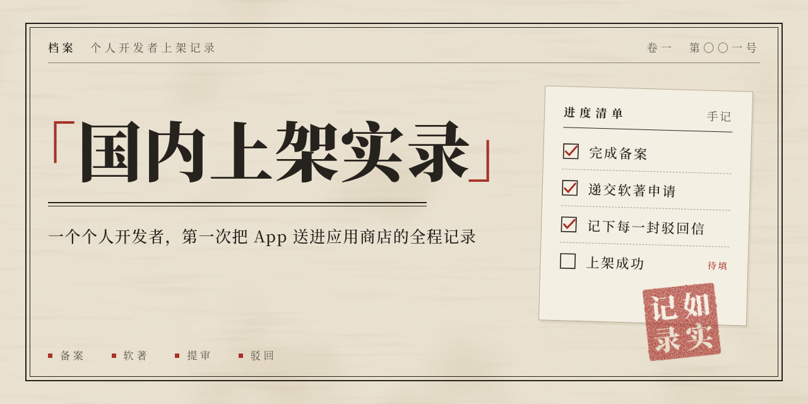

我还没上架成功过任何一款软件，正在走全程，走完一步记一步，被拒了就把拒信记下来。

> 本项目仍在进行中。作者尚未成功上架过任何软件。本内容不构成法律意见。

# 国内个人开发者上架实录

## 这是什么

我用《拉了么》跑这次流程。它是一个个人如厕记录 Android App，也有用 workBuddy 开发的微信小程序版。这里记录我办理备案、申请软著、准备后端与隐私材料，以及之后逐家提审的过程。

## 适合谁

这份开源实录写给第一次上架的个人开发者。如果你正准备提交 Android App 或微信小程序，可以先用第 07 章对照自己的材料，再按遇到的问题回查对应章节。

## 章节导览

| 章节 | 当前状态 | 记到哪一步 |
| --- | --- | --- |
| [01 工信部备案](01-备案.md) | 进行中 | 小程序备案已通过，安卓版的备案情况待补 |
| [02 软件著作权登记](02-软著.md) | 进行中 | 安卓版和小程序版均已提交，均在受理中 |
| [03 后端合规](03-后端合规.md) | 进行中 | 公网 HTTPS、SMTP 发码请求和 Android 真机联调已跑通，已核对加密定时备份和隔离恢复。隐私政策待核实，账号功能已有后端开发分支，正式上线待验证 |
| [04 安卓商店](04-安卓商店.md) | 口径已调研 | 调研覆盖五家，vivo 国内个人资格及应用宝细则待核，均未提审 |
| [05 小程序提审](05-小程序提审.md) | 口径已调研 | 拟选「工具 → 健康管理」，后台实际选择待核，正式 AppID 和提审记录待亲历 |
| [06 被拒档案](06-被拒档案.md) | 未开始 | 已备好空白模板 |
| [07 自查清单](07-自查清单.md) | 进行中 | 已勾选生产加密备份和隔离恢复，隐私政策、账号功能与正式提审仍待验证 |

## 跨平台政策专题

- [iOS｜苹果中国区新规](cross-platform/ios/08-苹果中国区新规.md)。官方政策已核实／个人 iOS 申报未实操。存量 App 须于 2027-01-31 前完成两项声明并通过验证。

## 当前进度

后端已上线，Android 联调版已在真机跑通登录、激活、同步和导出。安卓各商店和小程序都还没正式提审，现有项目仍为游客 AppID，备案主体、正式 AppID 与待审包的对应关系待核。

## 更新方式

今后新增实录一律使用[统一记录模板](TEMPLATE-记录.md)。亲历一步就补记对应章节，同步更新进度表和第 07 章。收到审核反馈后，在第 06 章留存脱敏后的原文，补记整改和复审结果。安卓商店与微信小程序的调研见第 04、05 章，iOS 政策见上方专题。具体要求以各平台官方口径为准。

[更新日志](CHANGELOG.md)

[English](README.en.md) · [智能体查阅与续写入口](SKILL.md)
